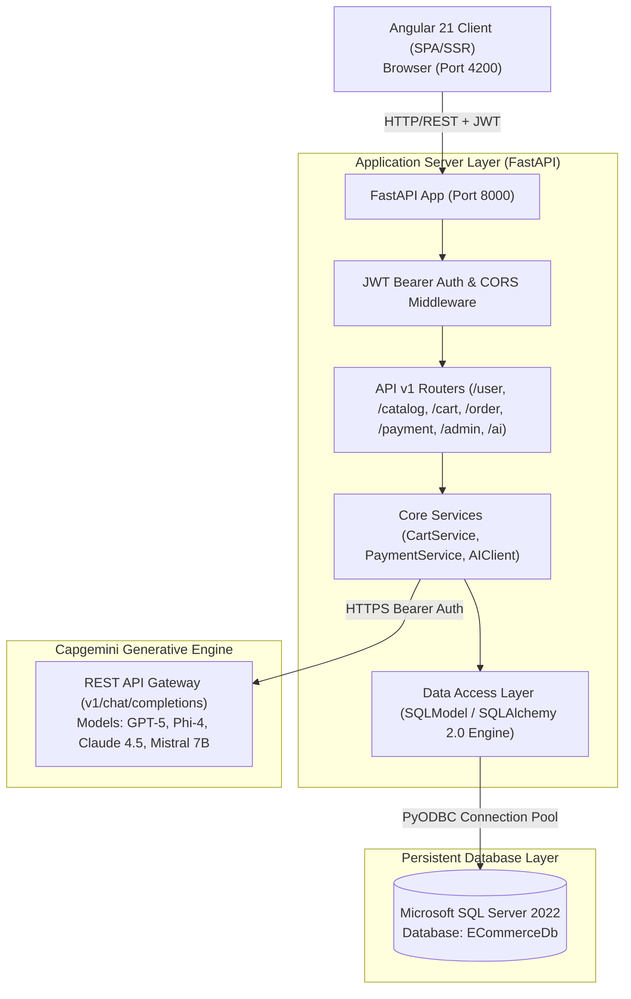

# High-Level Design (HLD) - LuxeMart E-Commerce System

## 1. System Architecture & Topology

---

## 2. Architectural Principles & Patterns

1. **Layered Modular Architecture**:
   - **Presentation Layer (Frontend)**: Angular 21 Standalone Components, Signal-based reactivity, Reactive Forms.
   - **API Gateway / Routing Layer**: FastAPI routers partitioned by domain (`/user`, `/catalog`, `/cart`, `/order`, `/payment`, `/admin`, `/ai`).
   - **Business Logic Layer**: Encapsulated service classes (`CartService`, `PaymentService`, `AIClient`).
   - **Persistence Layer**: SQLModel / SQLAlchemy ORM utilizing connection pooling with `fast_executemany` for high throughput.
2. **Stateless Authentication**:
   - JWT tokens (HMAC-SHA256) signed with server secret; claims include user ID, role, and expiration timestamp.
3. **Database Grounding for Conversational AI**:
   - AI assistant avoids hallucinations by injecting real-time database catalog items, pricing, inventory stock, and authenticated user orders into system context.

---

## 3. Subsystem Breakdown

| Subsystem | Technology | Responsibilities |
|---|---|---|
| **Identity & Access** | FastAPI, PyJWT, Bcrypt | User registration, authentication, RBAC (`Admin` vs `Customer`), token lifecycle. |
| **Catalog & Inventory** | SQLModel, SQL Server | Taxonomy categories, products, stock levels, faceted filtering, search, appraisals. |
| **Cart & Order Processing** | CartService, OrderService | Cart calculation, tax/shipping logic, checkout, stock deduction, order milestone tracking. |
| **Payment Gateway Simulation** | PaymentService | Multi-method settlement (Card, UPI, Netbanking, COD), transaction tracking. |
| **AI Shopping Concierge** | Capgemini GenEngine, Httpx | Multi-model chat completion, catalog grounding, product suggestion extraction. |
| **Admin Control Console** | Angular, Admin API | Store analytics (revenue, order counts, low stock alerts), product & category CRUD. |

---

## 4. Security & Compliance Architecture

- **Password Storage**: Passwords hashed using `bcrypt` with unique cryptographic salts.
- **Authentication**: JWT Bearer token passed via HTTP `Authorization` header, validated by FastAPI dependency injection.
- **SQL Injection Prevention**: Parameterized queries enforced across all database queries via SQLAlchemy/SQLModel.
- **Cross-Origin Resource Sharing (CORS)**: Configured explicitly for frontend origins.
- **Role-Based Guards**: Frontend route guards (`authGuard`, `adminGuard`) paired with backend dependency guards (`get_current_user`, `get_current_admin`).

---

## 5. Non-Functional Requirements (NFRs)

- **Performance**: P95 response time < 150ms for catalog reads; database connection pooling enabled.
- **Reliability**: Graceful fallback responses in AI client if remote Generative Engine is unreachable.
- **Scalability**: Stateless backend design permits horizontal scaling behind a reverse proxy (e.g. NGINX).
- **Data Integrity**: Foreign key constraints and transactional integrity across cart checkout and inventory decrementing.
