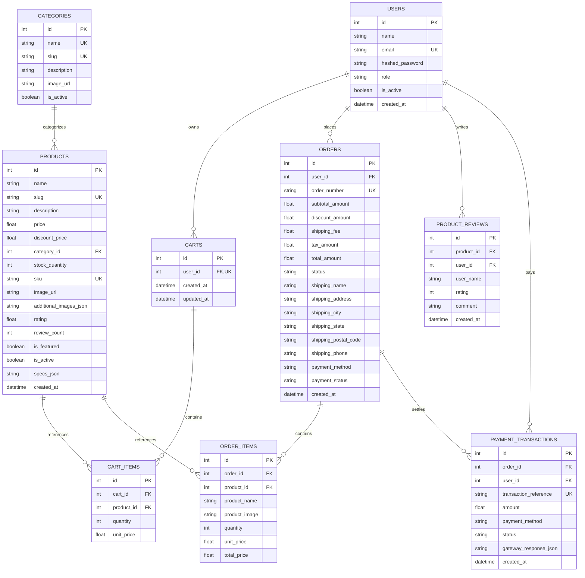
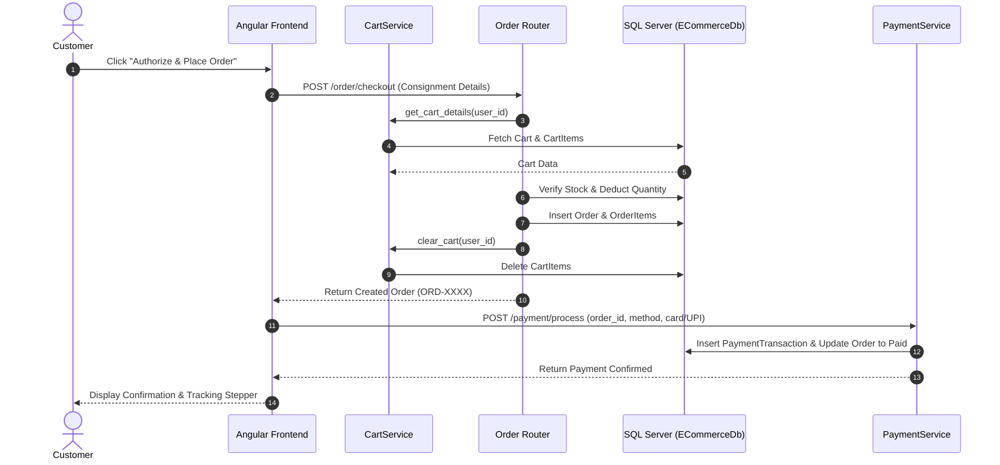
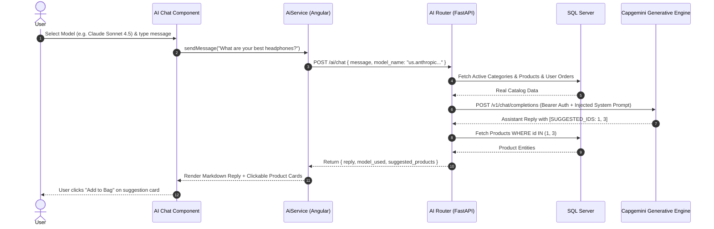

# Low-Level Design (LLD) - LuxeMart E-Commerce System

## 1. Database Schema & Entity Relationships



---

## 2. API Specifications & Data Contracts

### 2.1 Authentication & User Management
- `POST /api/v1/user/register`
  - **Body**: `{ name: str, email: str, password: str, role?: "Customer" | "Admin" }`
  - **Response (201)**: `{ access_token: str, token_type: "bearer", user: UserRead }`
- `POST /api/v1/user/login`
  - **Body**: `{ email: str, password: str }`
  - **Response (200)**: `{ access_token: str, token_type: "bearer", user: UserRead }`
- `GET /api/v1/user/me`
  - **Header**: `Authorization: Bearer <token>`
  - **Response (200)**: `UserRead`

### 2.2 Catalog & Product Operations
- `GET /api/v1/catalog/categories`
  - **Response (200)**: `List[CategoryRead]` (includes `product_count`)
- `GET /api/v1/catalog/products`
  - **Query Params**: `search`, `category_id`, `min_price`, `max_price`, `sort_by` (`newest`, `price_asc`, `price_desc`, `rating`, `name`), `in_stock_only`, `page`, `page_size`
  - **Response (200)**: `{ items: List[ProductRead], total: int, page: int, page_size: int, pages: int }`
- `GET /api/v1/catalog/products/{id}`
  - **Response (200)**: `ProductRead` (includes parsed specs, category name, verified reviews list)
- `POST /api/v1/catalog/products` *(Admin Only)*
  - **Body**: `ProductCreate`
  - **Response (201)**: `ProductRead`
- `POST /api/v1/catalog/products/{id}/reviews` *(Authenticated User)*
  - **Body**: `{ rating: int (1-5), comment: str }`
  - **Response (201)**: `ReviewRead`

### 2.3 Shopping Bag & Cart
- `GET /api/v1/cart`: Returns user cart with live subtotal, discount, shipping, tax, and item count.
- `POST /api/v1/cart/items`: `{ product_id: int, quantity: int }`
- `PUT /api/v1/cart/items/{item_id}`: `{ quantity: int }`
- `DELETE /api/v1/cart/items/{item_id}`: Removes item.
- `DELETE /api/v1/cart/clear`: Clears cart.

### 2.4 Checkout & Orders
- `POST /api/v1/order/checkout`
  - **Body**: `{ shipping_name, shipping_address, shipping_city, shipping_state, shipping_postal_code, shipping_phone, payment_method }`
  - **Logic**: Validates inventory stock, creates `Order` and `OrderItem` records, deducts stock, empties cart.
  - **Response (201)**: `OrderRead`
- `GET /api/v1/order/my-orders`: List user's orders with milestone tracking.
- `PUT /api/v1/order/{id}/status` *(Admin Only)*: Update fulfillment status (`Processing`, `Shipped`, `Delivered`, `Cancelled`).

### 2.5 Payments
- `POST /api/v1/payment/process`
  - **Body**: `{ order_id: int, payment_method: str, card_number?: str, card_holder?: str, expiry?: str, cvv?: str, upi_id?: str }`
  - **Response (200)**: `{ success: bool, transaction_reference: str, order_id: int, amount: float, status: str, message: str, created_at: datetime }`

### 2.6 AI Assistant
- `GET /api/v1/ai/models`: List 4 supported models (`openai.gpt-5`, `phi-4-mini-reasoning`, `us.anthropic.claude-sonnet-4-5-20250929-v1:0`, `mistral.mistral-7b-instruct-v0:2`).
- `POST /api/v1/ai/chat`:
  - **Body**: `{ message: str, model_name?: str, history?: List[ChatMessage] }`
  - **Response (200)**: `{ reply: str, model_used: str, suggested_products: List[ProductRead] }`

---

## 3. Core Business Services Logic

### 3.1 Cart Calculations (`CartService`)
$$\text{Subtotal} = \sum (\text{Effective Price} \times \text{Quantity})$$
$$\text{Shipping Fee} = \begin{cases} \$0.00 & \text{if } \text{Subtotal} \ge \$100 \text{ or } \text{Subtotal} = 0 \\ \$15.00 & \text{otherwise} \end{cases}$$
$$\text{Discount} = \begin{cases} \text{Subtotal} \times 0.05 & \text{if } \text{Subtotal} > \$200 \\ \$0.00 & \text{otherwise} \end{cases}$$
$$\text{Estimated Tax} = (\text{Subtotal} - \text{Discount}) \times 0.08$$
$$\text{Total Investment} = \text{Subtotal} - \text{Discount} + \text{Shipping Fee} + \text{Estimated Tax}$$

### 3.2 AI Grounding & Prompt Template (`AIClient`)
1. Fetches active categories and top 40 products from SQL Server.
2. Injects product IDs, names, prices, stock, ratings, and descriptions into the system prompt.
3. If user is authenticated, appends recent 5 orders for real-time tracking lookup.
4. Generates completion via Capgemini Generative Engine.
5. Parses `[SUGGESTED_IDS: x, y]` tag from model response to attach full structured product cards in JSON response.

---

## 4. Sequence Diagrams

### 4.1 Order Placement Flow



### 4.2 AI Chatbot Flow with Dynamic Model Selection



---

## 5. Angular Frontend Component Tree & Signals

```
App (Root)
├── ToastComponent (ToastService.toasts)
├── NavbarComponent (AuthService.currentUser, CartService.itemCount)
├── RouterOutlet
│   ├── CatalogListComponent (products, categories, filters)
│   ├── ProductDetailComponent (product, galleryImages, reviews)
│   ├── CartComponent (CartService.cart, subtotal, shippingProgress)
│   ├── CheckoutComponent (shippingForm, paymentMethods)
│   ├── MyOrdersComponent (orders, stepTracker)
│   ├── LoginComponent (quickFill admin/customer)
│   ├── RegisterComponent
│   └── AdminDashboardComponent (AdminService.stats, productCRUDModal)
├── FooterComponent
└── AiChatComponent (AiService.messages, selectedModel, suggestedProducts)
```
