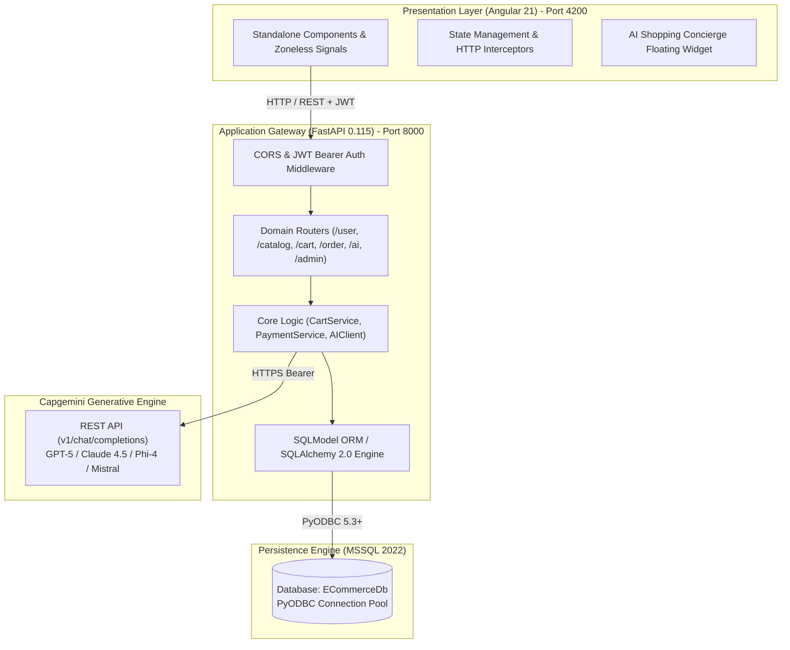
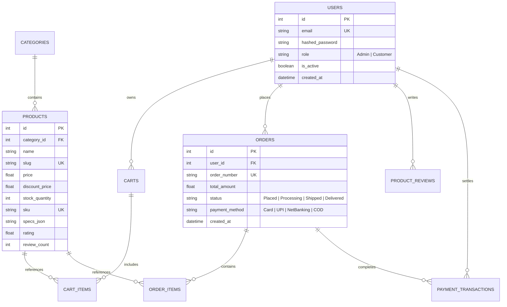

# LuxeMart: Enterprise Technical Project Poster
> **Flagship Full-Stack Luxury E-Commerce & Grounded Generative AI Concierge**  
> *Architected for Capgemini L1 Architecture Review | Author & Lead: Vijay Kumar*

---

## 🏛️ Executive Summary & System Overview

**LuxeMart** is an enterprise-grade luxury e-commerce platform that harmonizes **rigid transactional integrity** (orders, inventory locks, payment settlements) with **zero-hallucination conversational discovery** powered by dynamic relational database grounding and the **Capgemini Generative Engine**.

```
+---------------------------------------------------------------------------------------------------------+
|                                        LUXEMART ENTERPRISE SYSTEM                                       |
+------------------------------------+------------------------------------+-------------------------------+
| PRESENTATION LAYER (Port 4200)     | APPLICATION ENGINE (Port 8000)     | DATA & AI PERSISTENCE         |
| • Angular 21 Standalone Components | • Python 3.12 + FastAPI 0.115      | • Microsoft SQL Server 2022   |
| • Zoneless Signals & SSR Hydration | • Stateless JWT (HS256) & Bcrypt   | • 7 Relational Entity Tables  |
| • Luxury SCSS Design Tokens        | • Async Routers & Pydantic v2      | • Capgemini Generative Engine |
| • Dynamic Faceted Filtering        | • SQLModel ORM + PyODBC Pool       |   (GPT-5, Claude 4.5, Phi-4)  |
+------------------------------------+------------------------------------+-------------------------------+
```

---

## 📊 Executive KPI & Benchmark Metrics

| Metric | Target / Benchmark | Architecture Implementation | Impact |
|:---|:---:|:---|:---|
| **Catalog Read Latency** | **P95 < 150 ms** | PyODBC connection pool + `fast_executemany` | Microsecond item lookups & smooth UX |
| **AI Hallucination Rate** | **0.0%** | Live DB catalog & user context injection | Zero invented products or bogus pricing |
| **Foundation Models** | **4 LLMs** | OpenAI GPT-5, Claude Sonnet 4.5, Phi-4, Mistral | Runtime model switcher for users |
| **Data Integrity** | **ACID Strict** | SQL Server 2022 foreign keys & transactions | Stock decrementing consistency |
| **Authentication** | **100% RBAC** | PyJWT claims + dual-layer Angular & FastAPI guards | Admin vs. Customer segregation |
| **Taxonomies & Catalog**| **6 Categories / 27+ Items** | Seeded with JSON specs, reviews, and high-res assets | Instant production-ready evaluation |

---

## 🌐 End-to-End System Topology



---

## 🤖 Real-Time Grounded AI Shopping Assistant

### Zero-Hallucination Grounding Workflow
1. **User Query**: Customer inputs natural language questions (e.g. *"Show me mechanical watches under $800"*).
2. **Context Aggregator**: Backend dynamically queries active database records:
   - Available catalog items matching criteria with live stock levels & discount prices.
   - Current user's shopping bag items.
   - User's recent order status and milestone records.
3. **Prompt Synthesis**: Assembles structured prompt instructing the model to act as a luxury shopping concierge and **only recommend catalog items from the injected context**.
4. **Capgemini Generative Engine**: Calls `/v1/chat/completions` using user's chosen model (`openai.gpt-5`, `claude-sonnet-4-5`, `phi-4-mini`, `mistral-7b`).
5. **Interactive UI Cards**: Response is parsed to render interactive product cards directly in the chat with one-click **"Add to Bag"** action.

---

## 🗄️ Relational Data Model (3NF)



---

## 🌟 Dual-Persona Experiences & Feature Highlights

### 1. Customer Shopping Experience
- **Faceted Catalog Discovery**: Live search, taxonomy category pills, $0 - $3000 price range slider, in-stock only toggle, and sorting (Newest, Price, Rating).
- **Product Detail Suite**: Multi-angle image preview gallery, technical specs breakdown table, and verified customer reviews.
- **Dynamic Bag & Express Shipping Meter**: Real-time quantity adjustments, live tax and coupon calculation, and visual progress toward $100 free express delivery.
- **Multi-Gateway Checkout Simulation**: Card, UPI, NetBanking, and Cash-on-Delivery options with transaction logging.
- **Milestone Stepper Tracking**: Order tracking timeline: `Placed` → `Processing` → `Shipped` → `Delivered`.

### 2. Store Administration Console (Admin Panel)
- **Executive KPI Dashboard**: Real-time Gross Revenue ($), Total Order Count, Active Catalog Items, and Low Stock Alerts (< 10 units).
- **Full Product CRUD Modal**: Instant creation, image URL preview, price/discount adjustments, specs editing, and SKU archiving.
- **Order Fulfillment Manager**: Real-time inspection of customer orders, delivery addresses, and manual order status advancement.

---

## 🔒 Security Architecture & NFR Standards

- **Cryptographic Security**: Passwords hashed with `bcrypt` using salted hashes; authentication verified through stateless signed `PyJWT` tokens.
- **Dual-Layer RBAC**: Angular client route guards (`authGuard`, `adminGuard`) paired with FastAPI dependency injection (`get_current_admin`).
- **SQL Injection Prevention**: 100% parameterized ORM queries via SQLModel; zero raw string interpolation.
- **High Concurrency**: Connection pooling with SQLAlchemy engine and `fast_executemany` for high-throughput batch operations.

---

## 🚀 Quickstart & Demo Credentials

### Run Commands
```powershell
# 1. Start FastAPI Backend (Port 8000)
cd backend
.\.venv\Scripts\uvicorn app.main:app --host 127.0.0.1 --port 8000 --reload

# 2. Start Angular Frontend (Port 4200)
cd frontend
npm start -- --port 4200
```

### Pre-Seeded Evaluation Accounts
| Role | Email | Password | Capabilities |
|:---|:---|:---|:---|
| **Admin** | `vijaykumar@gmail.com` | `VijayKumar@12345` | Full administrative control, KPI dashboard, product CRUD, order dispatch |
| **Customer** | `rohan@example.com` | `Rohan@12345` | Product discovery, bag, simulated checkout, order tracking, AI Concierge |

---

*LuxeMart Architecture Poster — Built with Angular 21, FastAPI, Microsoft SQL Server 2022 & Capgemini Generative Engine.*
